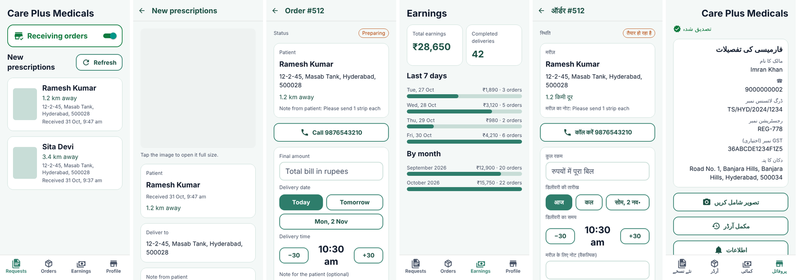

# Mcare+ Partner (pharmacy app)

The app pharmacies use to receive and deliver patients' prescription orders, rebuilt from scratch with Expo (SDK 58) for Android and iOS. The original source was lost. Screens and API calls follow the old `1.aab` build, and it uses the existing Laravel API at `https://maqsusi.care/api` (the `vendor` routes in `routes/api.php`).



## What a pharmacy can do

1. **Sign in** with phone OTP. A number already registered as a patient is told to use the Mcare+ app instead.
2. **Register the pharmacy**: owner, name, drug licence and registration numbers, GST (optional), address prefilled from the phone's GPS, shop photo.
3. **Upload documents**: drug licence (required) and GST certificate, as photos or PDF files.
4. **Wait for approval**: the app shows "verification in progress" until an admin approves the pharmacy in the admin panel. A rejected pharmacy can upload documents again.
5. **Go online** with the "Receiving orders" switch. Offline pharmacies get no new prescriptions.
6. **New prescriptions**: list with patient, distance and address (refreshes every 30 seconds). Open one to see the photo full size, call the patient, then **Accept** (creates the order) or **Reject** with a reason.
7. **Orders**: move each order through Accepted → Preparing → Ready for delivery → Out for delivery → Delivered with one big button. Before "Out for delivery" the app asks for the final amount, delivery date and time, as the API requires. The patient confirms receipt in their app, which completes the order.
8. **Earnings**: totals, last 7 days and by month, from confirmed deliveries.
9. **Profile**: view and edit pharmacy details, change photo, completed orders, export delivered orders for a month as Excel (CSV) or PDF and share them, notifications, language, help and FAQs, log out.

## Languages

English, Hindi, Telugu and Urdu, the same four as the old Partner app. Text is in `src/i18n/strings/<code>.ts`. To add a language, copy `en.ts`, translate it and add it to `src/i18n/index.ts`. The patient app already has eight more.

> **Needs native-speaker review.** The Hindi, Telugu and Urdu text was written without a native speaker.

## Run it

```bash
cd apps/partner
npm install
npm test              # order flow, delivery checks and sign-up stage
npm run typecheck
npx expo run:android  # or: npx expo run:ios (needs Xcode on a Mac)
```

`npx expo start --web` runs a browser preview.

## Release builds

- **Android package `com.mcarepartner`, versionCode 2.** The live app is versionCode 1, so this installs as an update. You need the original upload key, or ask Google Play to reset it (Play Console › Test and release › App integrity).
- **Push notifications:** put the Firebase `google-services.json` for `com.mcarepartner` in this folder (git-ignored). New-prescription pushes then arrive on the `admin_channel_v2` channel the backend uses.
- **iOS** (`com.mcarepartner`): builds and runs, but push needs the Firebase SDK, as in the patient app.
- Build in the cloud with EAS. Step by step: [../BUILDING.md](../BUILDING.md).

## Known follow-ups

- Not yet tested on a real phone.
