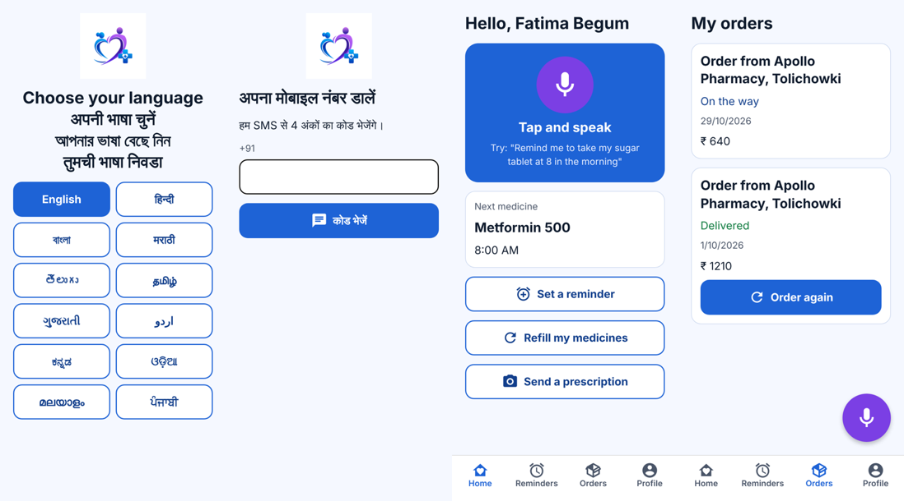
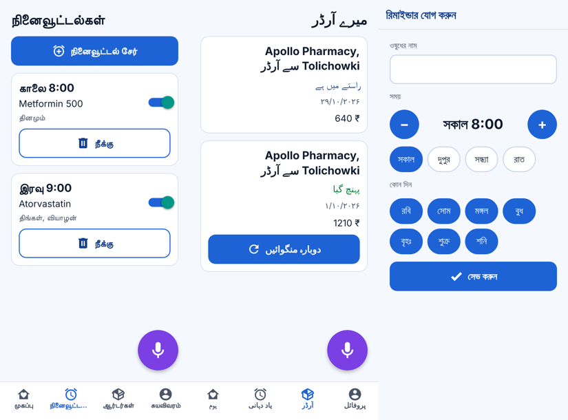

# Mcare+ patient app

The Mcare+ app for patients and elderly users, rebuilt from scratch with Expo (SDK 58) for Android and iOS from one codebase. It talks to the existing Laravel API at `https://maqsusi.care/api`.

The main new feature is **voice commands** in 12 languages, so older people can do everything by speaking:

| Say (any of the 12 languages) | What happens |
| --- | --- |
| "Remind me to take Metformin at 8 in the morning every day" | Reads it back, saves the reminder after "yes" |
| "Refill my medicines" / "पिछला ऑर्डर दोबारा मंगवा दो" | Finds the last delivered order, reads back the pharmacy and date, re-orders after "yes" |
| "I want to order medicines" | Opens the screen to photograph and send a prescription |
| "Where is my order?" | Reads out the status of the current order |
| "What are my reminders?" | Reads out the medicine reminders |




## How voice works

Everything runs on the phone. No AI service and no backend change is involved.

1. **Speech to text**: the phone's own recogniser (Google on Android, Apple on iOS) via `expo-speech-recognition`, in the language the person chose.
2. **Understanding**: rule-based parser in `src/voice/parse.ts`. It reads times ("8 baje", "সকাল ৮টায়", "ಬೆಳಿಗ್ಗೆ 8 ಗಂಟೆಗೆ", "साढ़े 9"), days, medicine names and the action. The 12 phrase lists in `src/voice/lexicon/` are merged, because people mix languages.
3. **Read back**: the app says what it understood with `expo-speech` and shows it in large text.
4. **Confirm**: nothing is saved or ordered until the person says "yes" (or "haan", "అవును", "ஆமாம்" …) or taps **Yes, confirm**. "No" cancels.

## Languages

English, Hindi, Bengali, Marathi, Telugu, Tamil, Gujarati, Urdu, Kannada, Odia, Malayalam and Punjabi: the top 11 Indian languages by number of speakers (Census 2011), plus English. The old app had English, Hindi, Telugu and Urdu.

- On-screen text and read-backs: `src/i18n/strings/<code>.ts`
- Voice phrases: `src/voice/lexicon/<code>.ts`
- Example sentences per language (tests): `src/voice/__tests__/languages.test.ts`

> **Needs native-speaker review.** All non-English text was written without a native speaker. Before release, have someone check each language's two files and add the phrasings real users say to the tests.

The text is bundled in the app, so it does not use the backend's `translations` table (which only has `en`, `hi`, `te` and `ur` columns).

## Run it

Voice needs native modules, so use a development build, not Expo Go.

```bash
cd apps/patient
npm install
npm test               # voice parser and read-back tests
npm run typecheck
npx expo run:android   # or: npx expo run:ios  (needs Xcode on a Mac)
```

`npx expo start --web` also runs a browser preview. Voice works there only in Chrome.

## Release builds

- **Android package `com.Mcare`, versionCode 5.** This matches the live Play Store app (versionCode 4), so the new app installs as an update. You need the original upload key, or ask Google Play to reset the upload key (Play Console › Test and release › App integrity).
- **Push notifications:** put the Firebase `google-services.json` (Android) in this folder. It is git-ignored on purpose. The backend's FCM pushes for orders then reach the app.
- **Medicine reminders ring as local phone alarms** (`src/reminders/alarms.ts`), so they work offline and survive battery saving. The app re-schedules them whenever the reminder list loads or changes. It tells the backend `local_reminders: true` when it saves the push token, so the server skips its own reminder push for this app and only old app versions get it. The backend side (`ReminderNotificationService`, `users.local_reminders`) is in the same pull request.
- **iOS** (`com.Mcare`): builds and runs, but push is not wired yet. The backend sends through FCM, so iOS needs the Firebase SDK to exchange the APNs token for an FCM token.
- Build in the cloud with EAS. Step by step: [../BUILDING.md](../BUILDING.md).

## Known follow-ups

- Until the backend part of this change is deployed (run `php artisan migrate`), people on the new app get each reminder twice (alarm and push).
- Urdu text is right-aligned, but the layout is not mirrored.
